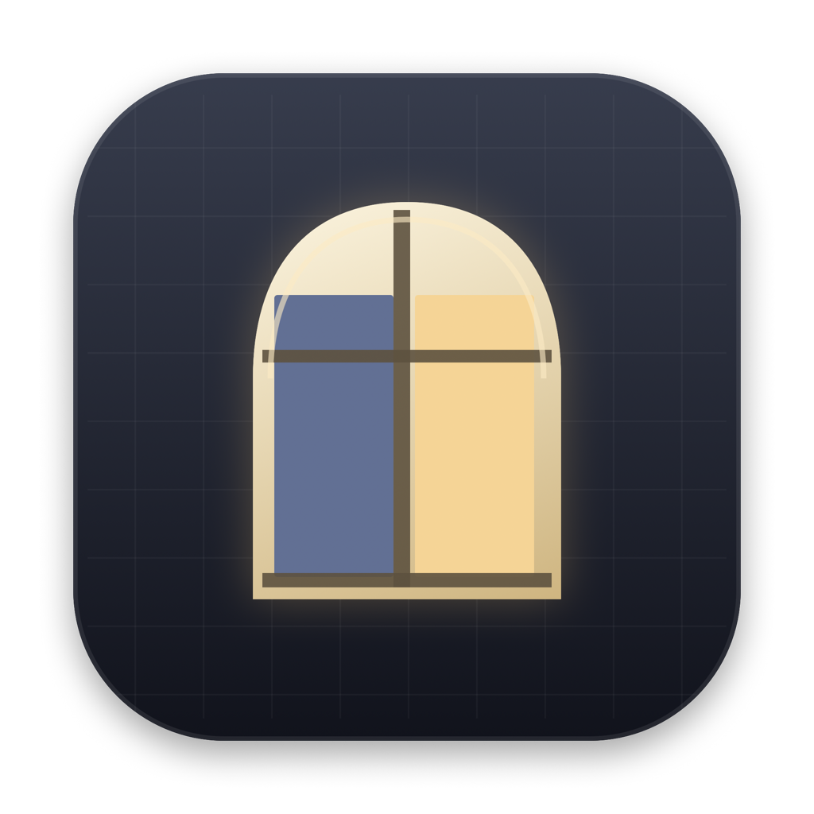
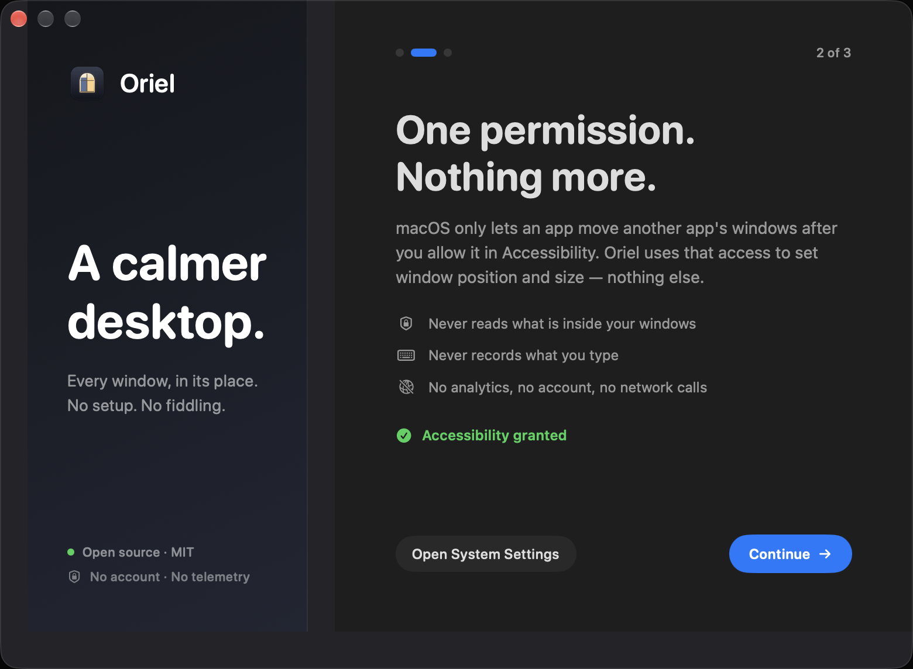
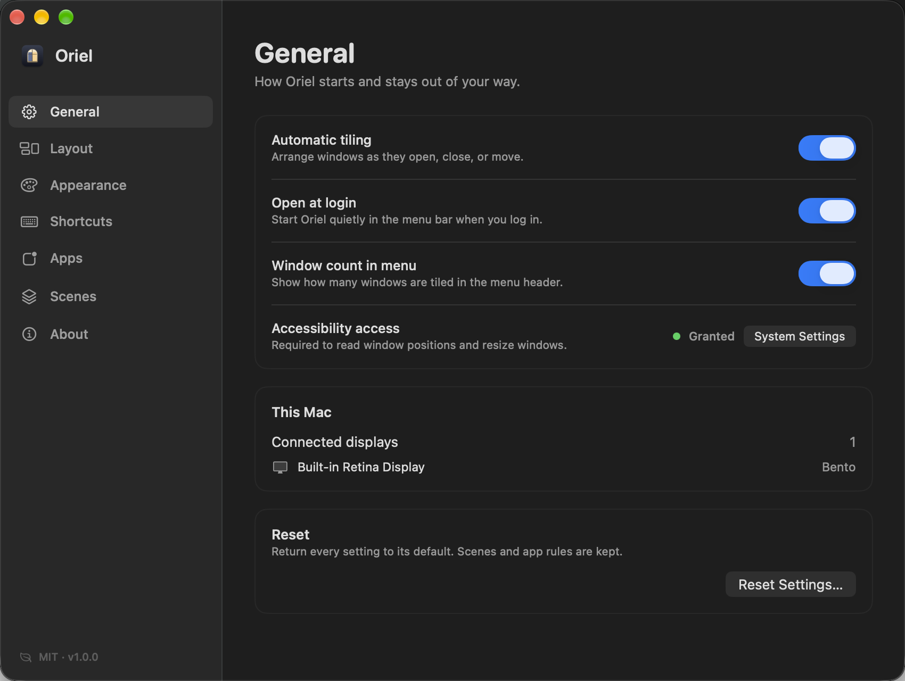

<div align="center">
  
  <h1>Oriel</h1>
  <p><strong>A calmer desktop for macOS.</strong></p>
  <p>Automatic tiling, five layouts, scenes, floating app rules, Overview, Focus and CLI automation.<br>Native AppKit + SwiftUI. No account. No telemetry.</p>
  <p>
    <a href="https://github.com/Irfanwani/oriel/releases/latest"><strong>Download for macOS →</strong></a>
    &nbsp;·&nbsp;
    <a href="https://irfanwani.github.io/oriel/">Website</a>
    &nbsp;·&nbsp;
    <a href="LICENSE">MIT License</a>
  </p>
</div>

<br>



Oriel keeps windows in their places as your day changes. Open a window and it gets a tile. Close one and the layout heals itself. There is no canvas to maintain and no subscription to think about.

It is built for macOS 14 and later, runs entirely on your Mac, and uses Accessibility only to read window geometry and move windows.

## Why Oriel

- **Quiet by default.** Oriel lives in the menu bar, tiles automatically, and gets out of the way.
- **A real Bento layout.** Not just another grid: a composed editorial arrangement with one hero window and supporting panes.
- **Rooms for different work.** Save a scene with apps, order, floating windows and per-display layouts; restore it in one click.
- **A desktop that explains itself.** Overview turns every window into a map. Focus clears the room. No Peek and Clean Space are made for calls and screen sharing.
- **Automation without an account.** A small CLI and `oriel://` URL API for layouts and scenes.
- **Open source, honestly.** MIT licensed, no analytics, no network calls, no paid tiers.

## Install

### Homebrew

```sh
brew install --cask irfanwani/oriel/oriel
```

This installs **Oriel.app** in `/Applications` and the **`oriel`** command in Homebrew's bin directory.

### Manual download

1. Download the latest `Oriel-1.0.0.dmg` from [Releases](https://github.com/Irfanwani/oriel/releases/latest).
2. Open the DMG and drag **Oriel.app** into **Applications**.
3. Launch Oriel and grant Accessibility when asked.

The DMG also includes the `oriel` CLI at its root. To install it manually:

```sh
sudo install -m 755 /Volumes/Oriel/oriel /usr/local/bin/oriel
```

### First launch

Oriel asks for **Accessibility** access. macOS requires this before any app can move another app's windows. Oriel uses it to read window positions and set window frames — nothing else.

After access is granted, choose a layout for your first display. Oriel starts tiling immediately. You can change the layout, window count and gap later from the menu bar or Settings.

> **Ad-hoc signing note:** Oriel is signed ad-hoc rather than with a paid Apple Developer certificate. Gatekeeper may ask you to approve it on first launch. If you install a new build, macOS may ask for Accessibility again because the signature changes. See [Troubleshooting](#troubleshooting).

## How it works

### Layouts

| Layout | What it does |
| --- | --- |
| **Grid** | A hero window with a folded stack of supporting windows. |
| **Columns** | Side-by-side, full-height columns. |
| **Rows** | Full-width rows, stacked top to bottom. |
| **Side** | A large main window with a narrow rail for everything else. |
| **Bento** | A composed editorial arrangement with one hero and smaller panes. |

Every display can have its own layout and capacity. Extra windows stack in the last tile, or float over the layout if you prefer. Empty space is never left behind: closing a window reflows the rest.



### The menu bar

Click the Oriel icon to:

- choose a layout and how many windows share the screen;
- open **Overview**, **Focus**, **No Peek** or **Clean Space**;
- save and restore scenes;
- pause tiling, retile manually, or change login behavior;
- jump into Settings or troubleshooting.

### Scenes

A scene remembers:

- the apps and windows on each display;
- their order;
- which windows were floating, and where;
- each display's effective layout, capacity and ratio.

Restoring a scene launches apps that are not running and retiles the windows that come back. It never touches document contents.

Save from **Settings → Scenes** or the menu bar. Restore with the menu, `oriel scene "Deep work"`, or an `oriel://scene/...` link.

### App rules

Some windows are better left alone. In **Settings → Apps** you can:

- mark apps as **Keep floating** so their windows never join the layout;
- exclude utility apps entirely with **Don't tile these apps**.

Floating windows are still visible in Overview.

### Overview, Focus and the two quiet modes

- **Overview** maps every window on the current display. Click a card to focus it, use arrow keys to move around, Space to cycle, and Return to focus. Esc closes.
- **Focus** expands the active non-floating window to the usable display area and remembers how to put everything back when you exit.
- **No Peek** dims everything except the active window. Designed for screen sharing.
- **Clean Space** covers every display with a plain backdrop, with no active-window hole or highlight. A clean stage for calls and screenshots.

No Peek and Clean Space do not require Screen Recording access.

## Keyboard shortcuts

The default prefix is **⌃⌥** (Control + Option). You can switch to **⌥⌘** (Option + Command) in **Settings → Shortcuts**.

| Action | Shortcut |
| --- | --- |
| Swap with window left / right / up / down | `⌃⌥←` `⌃⌥→` `⌃⌥↑` `⌃⌥↓` |
| Make active window bigger / smaller | `⌃⌥=` / `⌃⌥-` |
| Reset window sizes | `⌃⌥0` |
| Next / previous window | `⌃⌥]` / `⌃⌥[` |
| Next / previous window in stack | <code>⌃⌥&#96;</code> / <code>⌃⌥⇧&#96;</code> |
| Float or tile active window | `⌃⌥F` |
| Focus mode | `⌃⌥Z` |
| No Peek | `⌃⌥D` |
| Clean Space | `⌃⌥P` |
| Retile current display | `⌃⌥R` |
| Next / previous layout | `⌃⌥L` / `⌃⌥⇧L` |
| Overview | `⌃⌥Space` |
| Tile 1–5 windows | `⌃⌥1` … `⌃⌥5` |

Shortcuts are registered with macOS. Oriel does not install a keyboard event tap.

## CLI and URL automation

The `oriel` CLI is a tiny wrapper around the app's URL API. Most commands need Oriel to be running.

```sh
oriel layout bento
oriel count 3
oriel scene "Client call"
oriel save-scene "Deep work"
oriel focus
oriel float
oriel no-peek
oriel clean-space
oriel overview
oriel pause
oriel resume
oriel settings apps
oriel version
```

The same commands work as URLs:

```text
oriel://layout/bento
oriel://count/4
oriel://scene/Deep%20work
oriel://save-scene/Client%20call
oriel://focus
oriel://float
oriel://clean-space
oriel://overview
oriel://settings/scenes
```

Use them from Shortcuts, Raycast, Alfred, shell scripts, or anything else that can open a URL.

## Privacy

Oriel is deliberately boring about data:

- no telemetry, analytics, accounts or network calls;
- no Screen Recording permission;
- no keyboard event tap;
- window geometry and settings stay in `~/Library/Application Support/Oriel/settings.json`;
- scenes store app bundle identifiers, window order and floating-window frames — not window contents.

Accessibility access is used only to discover standard windows and set their position and size.

## Build from source

Requirements:

- macOS 14 or later;
- Xcode Command Line Tools (`xcode-select --install`);
- Swift 5.9 or later. The build script also works with only the Command Line Tools installed.

```sh
git clone https://github.com/Irfanwani/oriel.git
cd oriel

./scripts/build.sh                 # native arm64 build
ARCH=universal ./scripts/build.sh  # universal app
./scripts/test.sh                  # XCTest suite
ARCH=universal ./scripts/package.sh # DMG + SHA256
```

The app is written directly against AppKit and SwiftUI; there are no third-party dependencies. `scripts/build.sh` copies the icon and Info.plist, compiles the app, and ad-hoc signs the bundle. `scripts/package.sh` produces `dist/Oriel-1.0.0.dmg` and a matching `.sha256` file.

The package target intentionally contains only the testable Core module. The UI and app lifecycle are compiled by the release script so the repository can be built with Command Line Tools alone.

## Project layout

```text
Sources/
  AppDelegate.swift       App lifecycle, menu bar, URL API
  Core/
    LayoutEngine.swift     Pure tile geometry
    WindowManager.swift    Discovery, reconciliation, focus, scenes
    SceneManager.swift     Save/restore and app launching
    OverlayController.swift Borders, No Peek, Clean Space
    Accessibility.swift    AX helpers
    ...
  UI/
    OnboardingView.swift
    SettingsView.swift
    OverviewController.swift
    HUDController.swift
scripts/
  build.sh
  package.sh
  test.sh
  oriel                   CLI wrapper
Tests/
  OrielCoreTests.swift
```

## Troubleshooting

### macOS says Oriel cannot be opened

Oriel is not notarized because that requires a paid Apple Developer account. On first launch:

1. Open **System Settings → Privacy & Security**.
2. Scroll to the security section and click **Open Anyway** for Oriel.
3. Or right-click Oriel in Applications and choose **Open**.

If a downloaded copy is quarantined, this also works:

```sh
xattr -dr com.apple.quarantine /Applications/Oriel.app
```

### Windows are not moving

Check **System Settings → Privacy & Security → Accessibility** and make sure Oriel is enabled. After installing an update, toggle Oriel off and back on if it stopped working; the ad-hoc signature changes with each build.

### A shortcut does not work

Another app may already own the same key combination. Try switching the prefix in **Settings → Shortcuts**, then reopen Oriel.

### Login item did not register

macOS only registers login items for apps in `/Applications`. Move Oriel there, then enable **Open at login** again. If macOS asks for approval, allow Oriel under **System Settings → General → Login Items**.

### Open at login shows as on after a failed registration

Move Oriel to `/Applications`, turn the toggle off and on, and approve it in Login Items if prompted.

### Diagnostics

Choose **Troubleshooting…** from the menu bar to see Accessibility state, managed window counts, display settings and the settings file path. The report can be copied to the clipboard for a bug report.

## Contributing

Bug reports, design notes and pull requests are welcome. Start with [CONTRIBUTING.md](CONTRIBUTING.md) and the [open issues](https://github.com/Irfanwani/oriel/issues).

## License

Oriel is released under the [MIT License](LICENSE).

Built by [Irfan Wani](https://github.com/Irfanwani).
